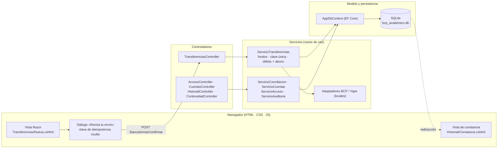
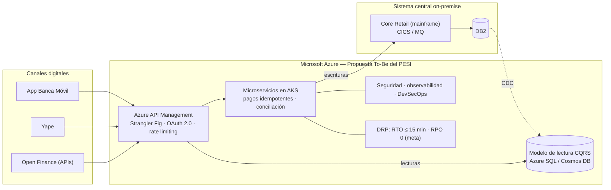

# Fuentes editables de los diagramas (Mermaid)

Pega cada bloque en https://mermaid.live o en un editor compatible (VS Code, Draw.io → Organizar → Insertar → Mermaid).
Los SVG finales de las diapositivas están en esta misma carpeta.

## 1. Arquitectura MVC implementada en el MVP local

## 2. Arquitectura empresarial propuesta (To-Be del PESI)

